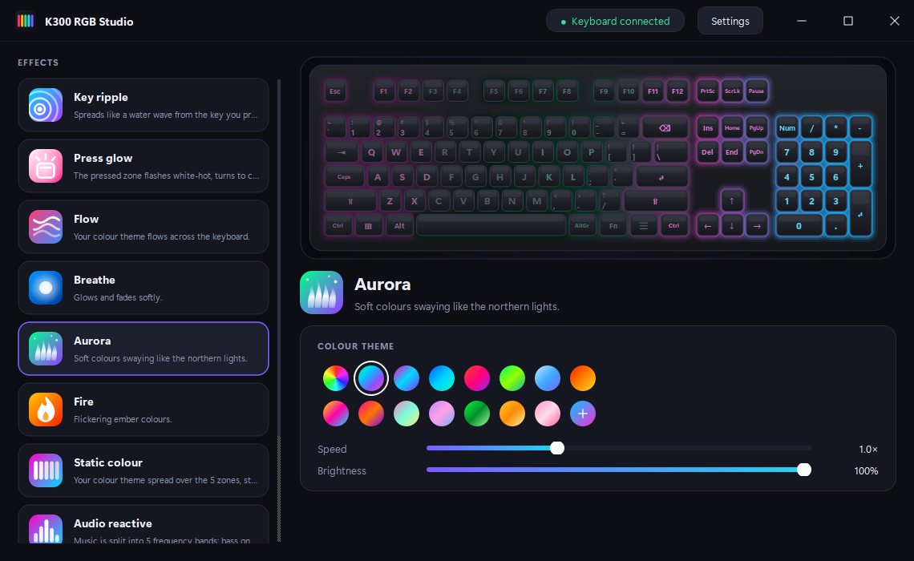
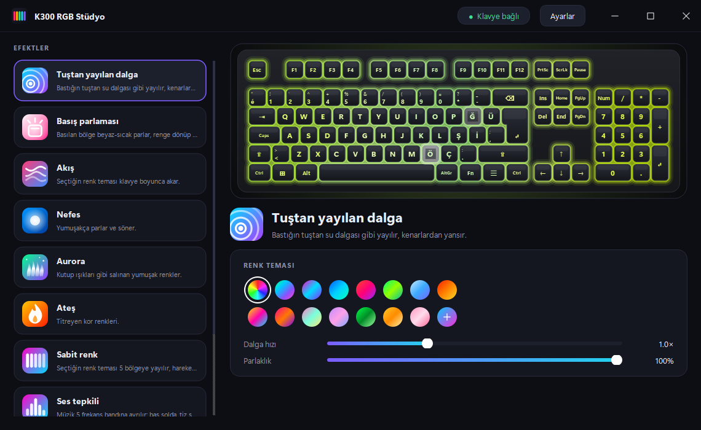

# K300 RGB Studio

An open-source, lightweight and good-looking lighting-effects app for the **Lenovo Legion K300** keyboard. It replaces the limited RGB options of Lenovo's *Legion Accessory Central* with a **ripple that spreads from every key you press**, press glow, audio reactivity, a system-load meter and more.

[Türkçe README](README.md) · [Protocol notes](docs/PROTOCOL.md)



<details>
<summary>Turkish Q layout and Turkish UI</summary>


</details>

## Features

| Effect | What it does |
|---|---|
| **Key ripple** | A water wave spreads from the key you press, bounces off the edges, with prism-like colour fringes |
| **Press glow** | The pressed zone flashes white-hot, turns to colour, fades; fast typing builds energy |
| **Surf**, **Drift** | Built-in keyboard effects (per key, like Legion's own). The palette is fixed in firmware (rainbow); speed is adjustable |
| **Breathe** | The whole keyboard glows and fades together, softly |
| **Aurora**, **Fire** | Ambient effects |
| **Static** | The theme spread over the 5 zones; with **Custom** you pick a colour for each zone |
| **Audio reactive** | Music split into 5 frequency bands: bass left, treble right |
| **Typing heat** | Blue when typing slowly, red when fast; you choose how many keys/s mean "full red" |
| **System load** | CPU or RAM usage as a bar on the keyboard |

* **15 ready-made colour themes** (Rainbow, Aurora, Neon, Ocean, Sunset, Forest, Ice, Fire, Cyberpunk, Retrowave, Candy, Lavender, Matrix, Gold, Sakura) and a **custom two-colour gradient**
* **Live preview** on a real keyboard: dark keycaps, light bleeding between the keys, tinted legends; the key you press lights up in the preview
* **Keyboard layout:** Turkish Q (default, ISO) or Global Q (ANSI). The preview and the key mapping follow your choice
* **Turkish / English** UI (default: your system language)
* Per-application profiles: switch effect automatically when a game is in the foreground
* Modern frameless window; runs in the system tray, can start with Windows; no admin rights needed to install

## Install

1. Download the latest **`K300RGBStudio-Setup-x.y.z.exe`** from [Releases](../../releases).
2. Run it and follow the wizard. Start it from the Start menu: **K300 RGB Studio**.

> **SmartScreen:** the installer is not code-signed, so Windows may show an "unknown publisher" warning (*More info → Run anyway*). Or build it yourself from source (below).

Requirements: Windows 10/11 (64-bit), a USB-connected Legion K300 (`17EF:60F0`).

## Limitations

* **5 lighting zones.** The keyboard's USB interface accepts only 5 zone colours; no per-key command was found ([details](docs/PROTOCOL.md)). Ripple and glow therefore work at zone resolution; the preview blends the zones smoothly.
* **15 frames/s to the device.** Streaming faster (30 fps) made the keyboard drop key presses during fast typing. The cap is intentionally fixed.
* **Key listener.** Reactive effects use a system-wide Windows keyboard hook. Only the key's **position** and time are used; what you type is never stored or sent ([`k300fx/inputs.py`](k300fx/inputs.py)). Some antivirus tools flag hooks, and keys pressed in apps running as administrator may not be seen. Keys that are not on the layout (media keys etc.) are ignored.
* **With Lenovo's app.** Both can run together, but each may overwrite the other's lighting; remove Lenovo's from startup if you don't use it.

## Run from source

```powershell
git clone https://github.com/ufukcagris/k300-rgb-studio
cd k300-rgb-studio
python -m venv .venv ; .\.venv\Scripts\Activate.ps1
pip install -r requirements.txt
python -m k300fx            # try without a keyboard: python -m k300fx --fake
```

Tests and installer: `pip install -r requirements-dev.txt`, `python -m pytest -q`, then `.\scripts\build.ps1` (needs [Inno Setup 6](https://jrsoftware.org/isinfo.php)). Pushing a tag such as `v1.0.0` makes the [workflow](.github/workflows/build.yml) build the installer and attach it to a release.

**Adding an effect:** subclass `Effect` in `effects.py` and add it to `EFFECT_CLASSES`; add a glyph to `EFFECT_GLYPHS` in `icons.py` and English strings to `EN` in `i18n.py` (a test catches missing translations).
**Adding a keyboard layout:** define the keys with geometry and scan codes in `layouts.py` and add it to the settings dialog.

## Disclaimer

Unofficial; not affiliated with, endorsed or supported by Lenovo. *Lenovo* and *Legion* are trademarks of their owners. The app only sends lighting commands: it does not write firmware and does not touch key mappings. Use at your own risk. No Lenovo code or firmware is included; the protocol was observed on the author's own device for interoperability.

## Author

[ufukcagris](https://github.com/ufukcagris) · License: [MIT](LICENSE)
