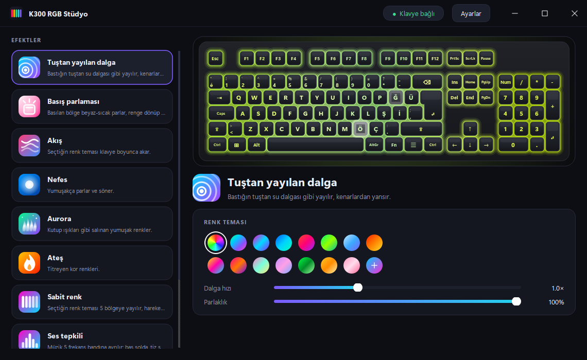
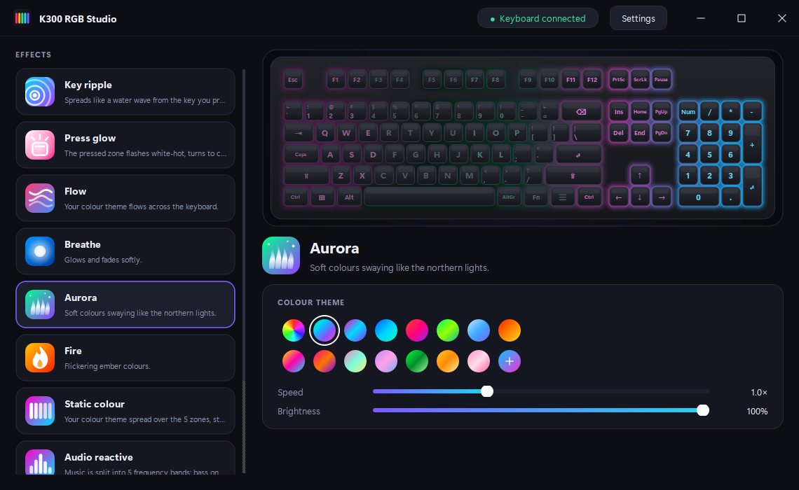

# K300 RGB Stüdyo

**Lenovo Legion K300** klavye için açık kaynak, hafif ve şık bir ışık efekti programı. Lenovo'nun *Legion Accessory Central* uygulamasındaki sınırlı RGB seçeneklerinin yerine geçer: **tuştan yayılan dalga**, basış parlaması, müziğe tepki, sistem yükü göstergesi ve daha fazlası.

[English README](README.en.md) · [Protokol notları](docs/PROTOCOL.md)



<details>
<summary>Global Q düzeni ve İngilizce arayüz</summary>


</details>

## Özellikler

| Efekt | Ne yapar |
|---|---|
| **Tuştan yayılan dalga** | Bastığın tuştan su dalgası gibi yayılır; kenarlardan yansır, renkler prizma gibi ayrışır |
| **Basış parlaması** | Basılan bölge beyaz-sıcak parlar, renge dönüp söner; hızlı yazdıkça enerji birikir |
| **Sörf**, **Sürükleme** | Klavyenin kendi içinde çalışan donanım efektleri (Legion'daki gibi, tuş tuş). Renkler klavyede sabit gökkuşağı; hız ayarlanır |
| **Nefes** | Tüm klavye aynı anda yumuşakça parlar ve söner |
| **Aurora**, **Ateş** | Ambiyans efektleri |
| **Sabit renk** | Tema 5 bölgeye yayılır; **Özel**'de her bölgeye ayrı renk seçersin |
| **Ses tepkili** | Müzik 5 frekans bandına ayrılır: bas solda, tiz sağda |
| **Yazma hızı ısısı** | Yavaş yazarken mavi, hızlandıkça kırmızı; kırmızıya kaç tuş/sn'de ulaşacağını sen seçersin |
| **Sistem yükü** | İşlemci ya da RAM kullanımı klavyede bar olarak görünür |

* **15 hazır renk teması** (Gökkuşağı, Aurora, Neon, Okyanus, Gün batımı, Orman, Buz, Ateş, Siberpunk, Retro dalga, Şeker, Lavanta, Matrix, Altın, Sakura) ve **iki renkli özel gradyan**
* Gerçek klavye üzerinde **canlı önizleme**: koyu tuş kapakları, aralardan sızan ışık, renkli harfler; bastığın tuş önizlemede parlar
* **Klavye düzeni seçimi:** Türkçe Q (varsayılan, ISO) ve Global Q (ANSI). Önizleme ve tuş eşleme seçime göre değişir
* **Türkçe / İngilizce** arayüz (varsayılan: sistem dili)
* Uygulamaya özel profil: oyun açılınca otomatik başka efekt
* Çerçevesiz modern pencere; sistem tepsisinde çalışır, Windows ile birlikte başlatılabilir
* Kurulum için yönetici yetkisi gerekmez

## Kurulum

1. [Releases](../../releases) sayfasından en son **`K300RGBStudio-Setup-x.y.z.exe`** dosyasını indir.
2. Çalıştır ve sihirbazı izle. Başlat menüsünden **K300 RGB Studio** ile açılır.

> **SmartScreen uyarısı:** Kurulum dosyası kod imzalama sertifikasıyla imzalı değil. Windows "Bilinmeyen yayıncı" uyarısı verebilir: *Daha fazla bilgi → Yine de çalıştır*. Güvenmek istemezsen kaynak koddan kendin derleyebilirsin (aşağıda).

Gereksinimler: Windows 10/11 (64 bit), USB ile bağlı Legion K300 (`17EF:60F0`).

## Bilmen gerekenler (sınırlar)

* **5 bölgeli ışık.** Klavyenin USB arayüzü yalnızca 5 bölge rengi kabul ediyor; tuş başına renk komutu bulunamadı ([ayrıntı](docs/PROTOCOL.md)). Bu yüzden dalga ve parlama, tuş tuş değil bölge çözünürlüğünde görünür. Önizlemedeki klavye de aynı 5 bölgeyi pürüzsüzce yayarak gösterir.
* **Cihaza saniyede 15 kare gider.** Daha hızlı göndermek (30 kare/sn) klavyenin hızlı yazarken tuş kaçırmasına yol açtı. Bu sınır bilerek sabit ve ayarlanamaz.
* **Tuş dinleyici.** Efektlerin tuşlara tepki verebilmesi için Windows'ta sistem çapında bir klavye kancası kullanılır. Yalnızca basılan tuşun **konumu** ve zamanı kullanılır; hangi harfe bastığın hiçbir yerde saklanmaz ya da gönderilmez. Kaynak kod: [`k300fx/inputs.py`](k300fx/inputs.py). Bazı antivirüsler bu tür kancalara uyarı verebilir. Yönetici yetkisiyle çalışan programlardaki tuşlar görülemeyebilir (Windows kısıtı). Ses/medya tuşları gibi düzende olmayan tuşlar yok sayılır.
* **Lenovo uygulamasıyla birlikte.** İkisi aynı anda açıkken çalışır, ama birinin yaptığı ayar ötekinin üzerine yazabilir. Lenovo'nun uygulamasını kullanmayacaksan başlangıçtan kaldırman yeterli.
* Program kapanınca klavye son kareyi tutar.

## Kaynak koddan çalıştırma

```powershell
git clone https://github.com/ufukcagris/k300-rgb-studio
cd k300-rgb-studio
python -m venv .venv ; .\.venv\Scripts\Activate.ps1
pip install -r requirements.txt
python -m k300fx            # klavye olmadan denemek için: python -m k300fx --fake
```

Testler ve kurulum dosyası:

```powershell
pip install -r requirements-dev.txt
python -m pytest -q
.\scripts\build.ps1         # testler -> exe (PyInstaller) -> setup.exe (Inno Setup 6)
```

`build.ps1`, [Inno Setup 6](https://jrsoftware.org/isinfo.php) gerektirir (`winget install JRSoftware.InnoSetup`). GitHub'a bir `v1.0.0` gibi etiket gönderince [workflow](.github/workflows/build.yml) kurulum dosyasını kendisi derler ve Releases'e ekler.

## Proje yapısı

```
k300fx/
  effects.py    efektler ve renk temaları
  engine.py     60 kare/sn döngü, cihaza gönderim sınırı
  device.py     HID çıkışı (yalnızca 5 bölge renk komutu)
  layouts.py    klavye düzenleri (Türkçe Q ISO, Global Q ANSI): geometri + tarama kodu
  inputs.py     tuş dinleyici, ses bantları, sistem yükü
  ui.py         PySide6 arayüzü (çerçevesiz pencere, klavye önizlemesi)
  icons.py      kodla çizilen simgeler
  i18n.py       Türkçe / İngilizce metinler
  app.py        pencere yaşam döngüsü (dil değişiminde yeniden kurma)
installer/      Inno Setup betiği
docs/PROTOCOL.md   ters mühendislikle çıkarılan protokol notları
tests/          pytest
```

**Yeni efekt eklemek:** `effects.py` içinde `Effect`'ten türet ve `EFFECT_CLASSES`'a ekle; bir simge çizimini `icons.py` içindeki `EFFECT_GLYPHS` sözlüğüne, İngilizce adlarını `i18n.py` içindeki `EN` tablosuna yaz (test, eksik çeviriyi yakalar).
**Yeni klavye düzeni:** `layouts.py` içinde tuşları geometri ve tarama koduyla tanımla; ayar penceresindeki seçeneğe ekle.

## Sorumluluk reddi

Bu proje **resmî değildir**; Lenovo ile bağlantısı, onayı ya da desteği yoktur. *Lenovo* ve *Legion* ilgili sahiplerinin ticari markalarıdır. Program klavyeye yalnızca ışık komutlarını gönderir; bellenime (firmware) yazmaz ve tuş atamalarına dokunmaz. Yine de kullanım sorumluluğu sana aittir. Lenovo'nun yazılımından ya da bellenimden hiçbir kod bu depoda yer almaz; protokol, kendi cihazın üzerinde birlikte çalışabilirlik amacıyla gözlemlenerek çıkarılmıştır.

## Geliştirici

[ufukcagris](https://github.com/ufukcagris) · Lisans: [MIT](LICENSE)
